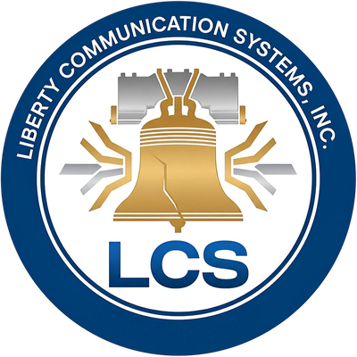
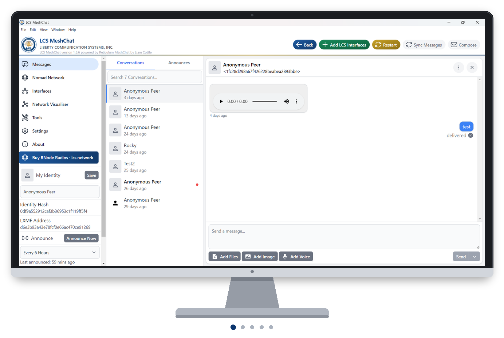
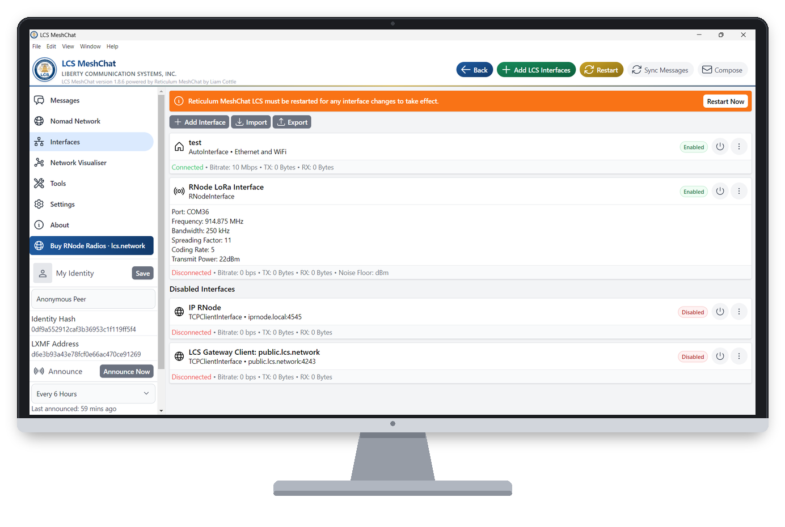
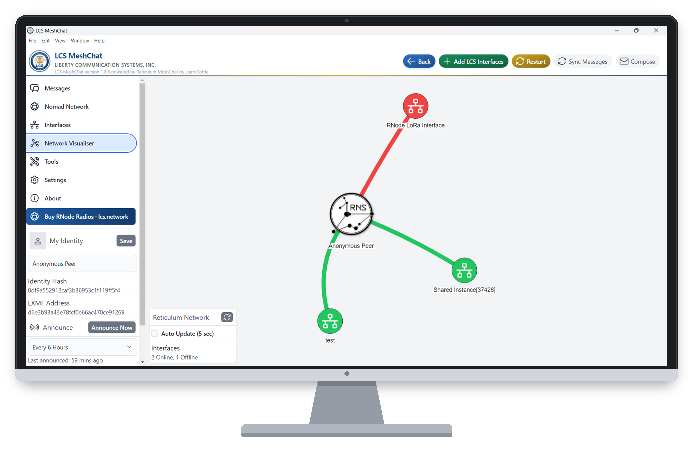
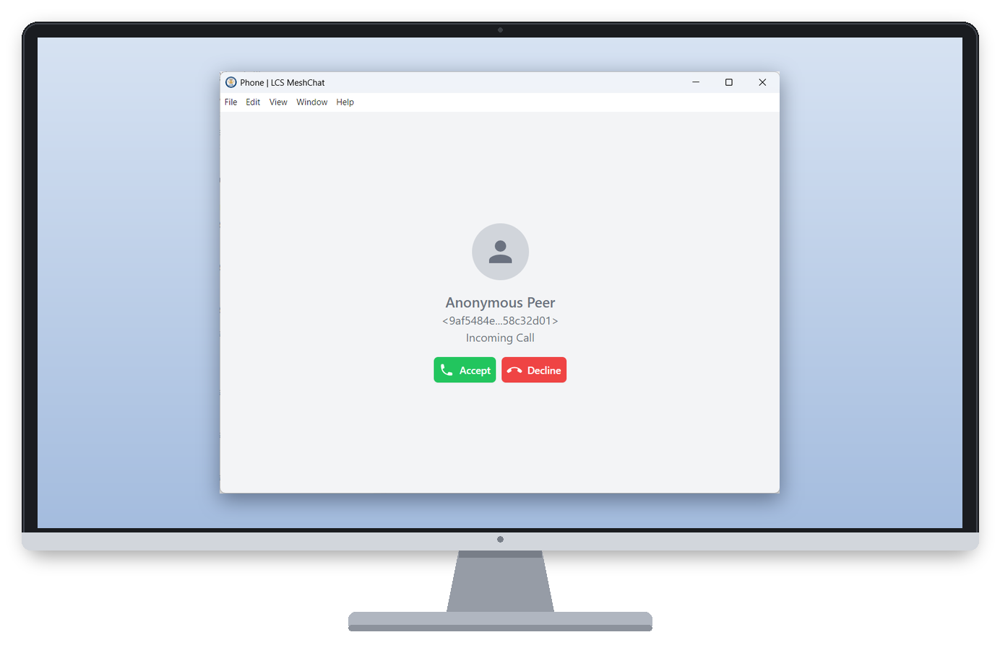
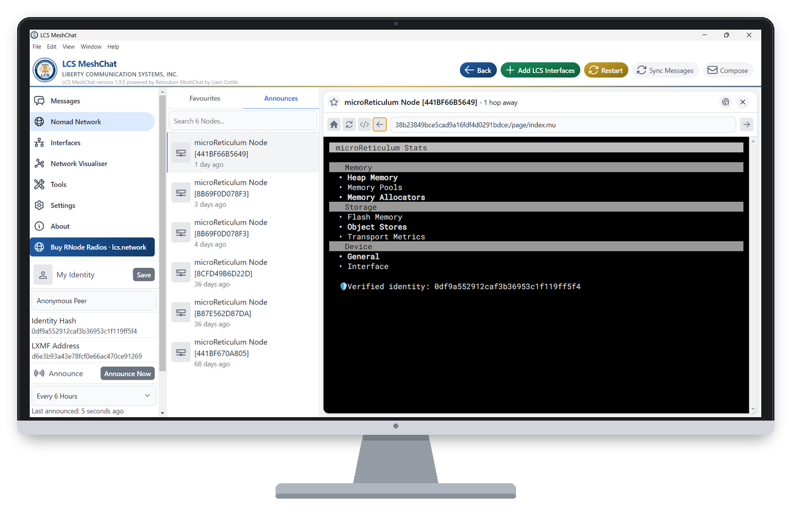

<p align="center">
  
</p>

<h1 align="center">LCS MeshChat</h1>

<p align="center">
  <b>Private messaging, voice calls and network tools for Reticulum, on Windows, macOS, Linux and Docker.</b><br>
  From Liberty Communication Systems, Inc. · <a href="https://lcs.network">lcs.network</a>
</p>

<p align="center">
  
</p>

<details>
<summary><b>See each screenshot</b></summary>
<br>
<p align="center">
  
  
  
  
  
</p>
</details>

---

LCS MeshChat sends encrypted messages and voice calls over Reticulum, a mesh
network that works without the internet. It connects over whatever you have:
local Wi-Fi and Ethernet, LoRa radios (RNode), or the internet through LCS Global.
It also works with Liberty Chat on Android, and with other Reticulum apps such as
Sideband and NomadNet.

No phone number, email address or account is needed.

## Install

**Desktop:** download the installer for Windows, macOS or Linux from this
repository's Releases page.

**Docker:** the short version is below. The full guide, including the HTTPS setup
that voice calls need in a browser, is in [docs/DOCKER.md](docs/DOCKER.md).

```sh
docker run -d --name lcs-meshchat --restart unless-stopped \
  -e LCS_DOCKER=1 -p 8082:8000 -v /opt/lcs-meshchat:/config \
  ghcr.io/daylight-hub/lcs-meshchat:latest \
  python meshchat.py --host=0.0.0.0 --port=8000 \
  --reticulum-config-dir=/config/.reticulum \
  --storage-dir=/config/.meshchat --headless
```

---

## Features

### Messaging
- End-to-end encrypted messages, pictures, files and voice clips
- Delivery status, and messages held for offline contacts on propagation nodes
- New-message chime and incoming-call ringtone
- Block contacts, and share or subscribe to block lists

### Voice calls
- Full duplex, or push-to-talk for slow links such as LoRa
- Switch between full duplex and push-to-talk, or change the codec (Codec2 or
  Opus), during a call without hanging up

### LCS Global
- Connects you to the Liberty network over Wi-Fi, Ethernet or mobile data, so you
  can reach people out of radio range
- Free 7-day trial, no data limits
- Sets itself up after payment: no codes or settings to type in
- Optional connection through Tor

### Easy setup
- **Add LCS Interfaces** adds LCS Global, Command Center PRO, IP RNode or a USB
  RNode LoRa radio in one step, and finds the radio's port for you
- RNode transmit power is matched to your radio board, so it can't silently fail
  to transmit
- Nine radio presets, from Short Turbo to Long Slow

### Reliable delivery
- A failed message asks the network for a fresh route and tries again before
  falling back to a propagation node
- Routes are kept across restarts
- Network connections that drop or are plugged in later recover by themselves
- A Path Request button in each conversation shows how a contact is reached

### Network tools
- Nomad Network browser
- Network visualiser
- Transport Node console, for nodes on your desk (USB, Bluetooth, Wi-Fi) or
  across the mesh
- RNode tools

### App
- Tells you when a new version is out
- Reset your identity without losing your old messages

---

## Documentation

| | |
|---|---|
| [Docker](docs/DOCKER.md) | Container install, HTTPS reverse proxy, troubleshooting |
| [Remote node management](docs/rns-console-bridge.md) | Managing transport nodes over Reticulum, and the one-time setup each node needs |
| [Raspberry Pi](docs/meshchat_on_raspberry_pi.md) · [Android/Termux](docs/meshchat_on_android_with_termux.md) | Other platforms |
| [Changelog](docs/CHANGELOG.md) | Version history |

## Privacy

LCS MeshChat does not collect, send or sell personal information. There is no
telemetry, no analytics, no crash reporting and no account. Your identity keys,
messages and settings stay on your own machine, and network traffic goes only to
the connections you set up. The code in this repository is what's built into the
released apps.

**Windows download warning.** Microsoft Edge and SmartScreen may say the installer
"is not commonly downloaded". That's a check on how often a file has been
downloaded, not on what it does, and it appears for any new release. It goes away
as a release gets more downloads.

---

## Credits

LCS MeshChat is built on these open-source projects:

- **Reticulum** by Mark Qvist: the networking and encryption stack
- **LXMF** by Mark Qvist: the message format and delivery protocol
- **LXST** by Mark Qvist: voice calls
- **Reticulum MeshChat** by Liam Cottle: the app LCS MeshChat was originally
  built from

Their license terms, and those of every other component the app includes, are in
[LICENSE](LICENSE) and
[THIRD-PARTY-LICENSES.txt](src/frontend/public/licenses/THIRD-PARTY-LICENSES.txt),
which is also shown in the app under About.

## License

Copyright © 2025–2026 Liberty Communication Systems, Inc. The LCS name, logos and
LCS's changes belong to Liberty Communication Systems, Inc. See [LICENSE](LICENSE).
